<picture>
  <source media="(prefers-color-scheme: dark)" srcset="assets/banner-dark.svg">
  
</picture>

<p align="center">
  
  
  
  
</p>

## 👋 Hey, I'm atu

I'm a **3rd-year student at New Mongol College of Technology**. I like building small, focused tools: the kind you install once and then forget about because they just work.
Most of what I make lives on the Mac or in the browse.

- 🛠️ Building **[Convrt](https://github.com/atuuuuuuu/Convrt)**, an offline file converter for the Mac menu bar
- 🌍 Hacking on **Earth Jukebox** for NASA Space Apps 2026: turning NASA ocean temperature maps into music you can hear
- 🌱 Learning more Swift, WebGL and audio programming

## 🚀 Featured projects

<table>
  <tr>
    <td width="50%" valign="top">
      <a href="https://github.com/atuuuuuuu/Convrt">
        
      </a>
      <h3>&nbsp;<a href="https://github.com/atuuuuuuu/Convrt">Convrt</a></h3>
      <p><b>Drag a file. Hold Shift. Drop it on a format.</b><br>
      A tiny, fully offline file converter that lives in the menu bar. A radial wheel of formats pops up right at your cursor, and the converted copy lands next to the original. Nothing is overwritten and nothing leaves your Mac.</p>
      
      
      
    </td>
    <td width="50%" valign="top">
      <h3>🌍 Earth Jukebox</h3>
      <p><b>NASA Space Apps 2026: The Earth Information Jukebox.</b><br>
      NASA sea surface temperature maps become music, live in the browser. A 3D WebGL globe shows what's playing, El Niño rings a bell, and you can tap the ocean to hear it. Built accessibility first: everything works with a keyboard and a screen reader.</p>
      
      
      
      
    </td>
  </tr>
  <tr>
    <td width="50%" valign="top">
      <h3>🖥️ <a href="https://github.com/atuuuuuuu/hubbercc">Hubber.cc Desktop</a></h3>
      <p>A desktop version of Hubber.cc for Windows, packaged as a portable app with Electron.</p>
      
      
    </td>
    <td width="50%" valign="top">
      <h3>🌐 <a href="https://github.com/atuuuuuuu/site">site</a></h3>
      <p>My corner of the web: a hand-written HTML page, no frameworks.</p>
      
      
    </td>
  </tr>
</table>

## 🧰 Toolbox

**Languages**<br>
     

**Frameworks and platforms**<br>
    

**Tools**<br>
   

## 🎯 Right now

```text
> studying      3rd year @ New Mongol College of Technology
> shipping      Convrt beta, offline file conversion for macOS
> hacking       Earth Jukebox for NASA Space Apps 2026
> producing     beats in FL Studio
```

<p align="center">
  <sub>Thanks for stopping by. Star something you like ⭐</sub>
</p>
